# Editor

## <a id="table-of-content">Table of content</a>

- [_Quick start instructions_](#quck-start)
  - [_Requirements_](#requirements)
  - [_Building_](#building)
- [_Configurations_](#configurations)
  - [_RenderDoc integration_](#renderdoc-integration)
  - [_NVIDIA Nsight Graphics integration_](#nsight-integration)
  - [_NVIDIA Aftermath integration_](#aftermath-integration)
  - [_PIX integration_](#pix-integration)
  - [_ASAN integration_](#asan-integration)
  - [_Debug build_](#debug-build)
  - [_Release build_](#release-build)
- [_Hotkeys_](#hotkeys)
  - [_Global_](#global-hotkeys)
  - [_Viewport_](#viewport-hotkeys)
  - [_Gizmo_](#gizmo-hotkeys)
  - [_Property tool_](#property-tool-hotkeys)
  - [_Transform tool_](#transform-tool-hotkeys)

## <a id="quck-start">Quick start instructions</a>

### <a id="requirements">Requirements</a>

* _Windows 11_+
* _Visual Studio 2026 Community 18.10.3_
  - Workloads: Desktop development with C++
  - Individual components
    - _MSBuild_
    - _MSVC Build tools v14.51 for x64/x86_
    - _Windows Universal CRT SDK_
    - _C++ core features_
    - _Windows 11 SDK (10.0.28000.2526)_
    - _Windows Universal C Runtime_
* [_PowerShell 7.6.9_](https://github.com/PowerShell/PowerShell/releases/tag/v7.6.9)
* [_RenderDoc v1.46_](https://renderdoc.org/)
* [_NVIDIA Nsight Graphics 2026.3.1.0 (build 38722833) (public-release)_](https://developer.nvidia.com/nsight-graphics)
* [_PIX 2603.25 / WinPixEventRuntime.\(dll|lib\) 1.0.240308001_](https://devblogs.microsoft.com/pix/download/)
* [_DirectX Shader Compiler v1.10.2609.10012_](https://github.com/microsoft/DirectXShaderCompiler) `717b24d7a487efb555e976104a263f93f181fd44`
* [_libfreetype 2.14.3_](https://gitlab.freedesktop.org/freetype/freetype) `d333439633039de426f943f28a2926c7f97b5ae5`
* [_stb_image 2.30_](https://github.com/nothings/stb) `2c980bb59875b0d32144a71867fbdebb2f77cd20`
* [_Vulkan SDK 1.4.357.0_](https://vulkan.lunarg.com/sdk/home)
* [_Vulkan Validation Layers 1.4.364_](https://github.com/KhronosGroup/Vulkan-ValidationLayers) `4315e7fd4500673692174ed4fee92277a200a7c5`

[↬ table of content ⇧](#table-of-content)

### <a id="building">Building</a>

To begin you have to run script with **administrator privileges**

`<repo>tools\editor\scripts\prepare-environment.ps1`

This script gonna create symbolic links for:

- asset directories
- [_PIX_](https://devblogs.microsoft.com/pix/) tooling library for _CPU_ tracing
- 3rd-party libraries

Open and compile `<repo>\tools\editor\editor.sln` solution via _Visual Studio_ as usual.

Last step is to edit _Visual Studio_ active configuration and specify working directory for `editor.exe`:

**_`editor` project properties_** → **_Debugging_** → **_Working Directory_** → **_Set to_** `$(OutputPath)`

ℹ️ Note: You need to do this once for every configuration.

That's it.

[↬ table of content ⇧](#table-of-content)

## <a id="configurations">Configurations</a>

### <a id="renderdoc-integration">_RenderDoc_ integration</a>

First step is to select _RenderDoc_ build configuration:

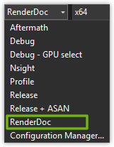

Next step is to [compile _HLSL_ code into _SPIR-V_ with shader sources](./shader-compilation.md#spirv-sources).

Under the hood it's used [_RenderDoc_ compatibility compile options](./renderdoc-integration.md).

The build artifacts will be located in directory:

`<repo>\tools\editor\bin\RenderDoc`

Now you will be able to use [_RenderDoc_](https://renderdoc.org/) for debugging:

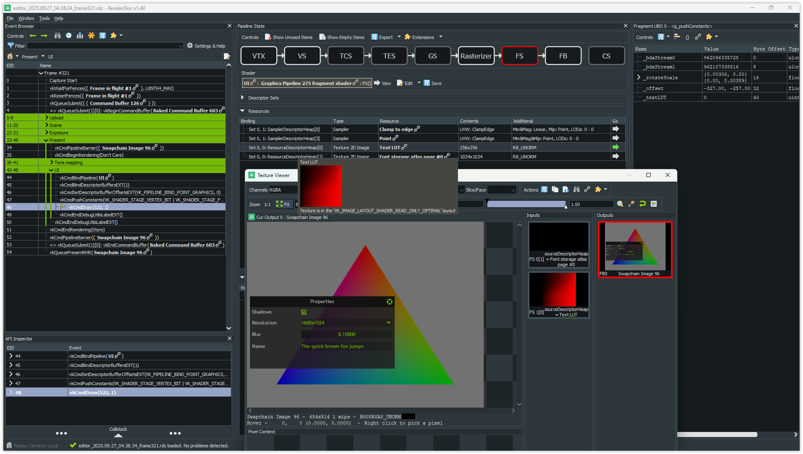

**Note:** It's expected that application will crash in case of running without _RenderDoc_. For performance reasons internal implementation does not check that the following debug functions are not `nullptr`.

- `vkCmdBeginDebugUtilsLabelEXT`
- `vkCmdEndDebugUtilsLabelEXT`
- `vkSetDebugUtilsObjectNameEXT`

The _RenderDoc Vulkan_ layer provides those functions.

[↬ table of content ⇧](#table-of-content)

### <a id="nsight-integration">_NVIDIA Nsight Graphics_ integration</a>

First step is to select _Nsight_ build configuration:

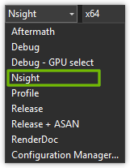

Next step is to [compile _HLSL_ code into _SPIR-V_ with shader sources](./shader-compilation.md#spirv-sources).

The build artifacts will be located in directory:

`<repo>\tools\editor\bin\Nsight`

Now you will be able to use [_NVIDIA Nsight Graphics_](https://developer.nvidia.com/nsight-graphics) for debugging:

Graphics debugger:

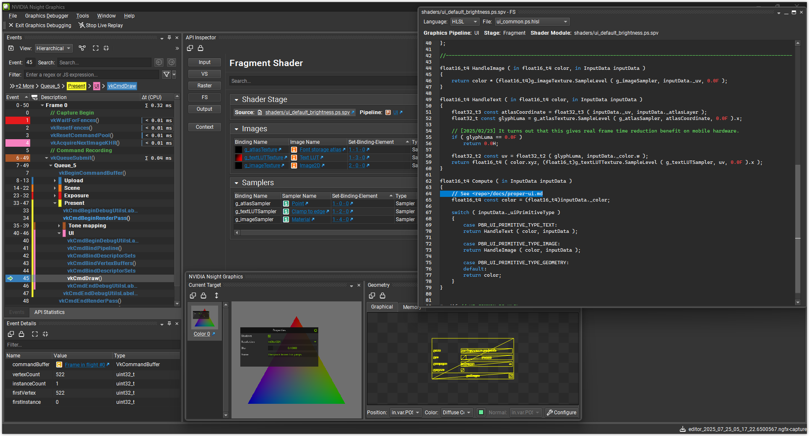

_GPU_ profiler:

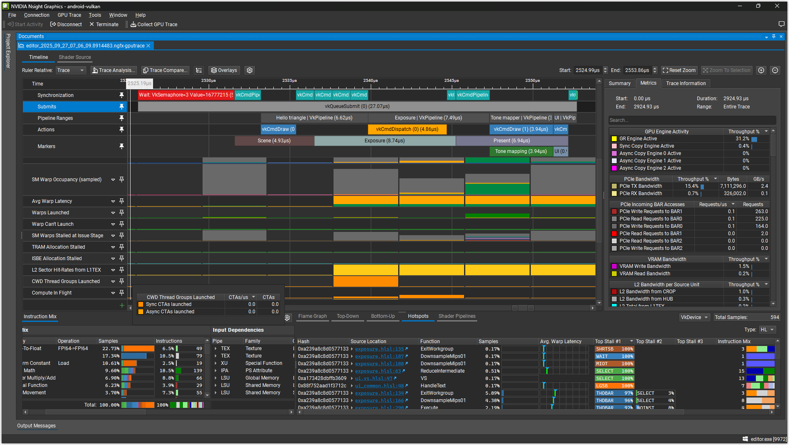

**Note:** It's expected that application could crash in case of running outside _NVIDIA Nsight Graphics_. For performance reasons internal implementation does not check that the following debug functions are not `nullptr`.

- `vkCmdBeginDebugUtilsLabelEXT`
- `vkCmdEndDebugUtilsLabelEXT`
- `vkSetDebugUtilsObjectNameEXT`

The _NVIDIA Nsight Graphics Vulkan_ layer provides those functions.

[↬ table of content ⇧](#table-of-content)

### <a id="aftermath-integration">_NVIDIA Aftermath_ integration</a>

First step is to select _Aftermath_ build configuration:

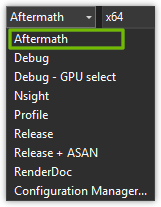

Next step is to [compile _HLSL_ code into _SPIR-V_ with shader sources](./shader-compilation.md#spirv-sources).

The build artifacts will be located in directory:

`<repo>\tools\editor\bin\Aftermath`

Now you will be able to use [_NVIDIA Aftermath_](https://developer.nvidia.com/nsight-aftermath) for debugging:

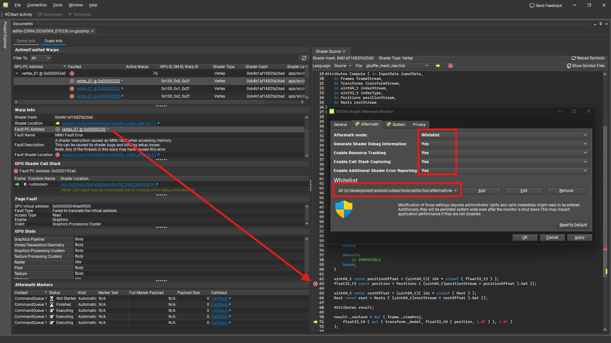

ℹ️ Pay attention that [_NVIDIA Nsight Graphics_](https://developer.nvidia.com/nsight-graphics) already contains [_NVIDIA Aftermath_](https://developer.nvidia.com/nsight-aftermath) components. So all you need is to activate [_NVIDIA Aftermath Monitor_](https://developer.nvidia.com/nsight-aftermath) tool and wait for application crash.

[↬ table of content ⇧](#table-of-content)

### <a id="pix-integration">_PIX_ integration</a>

First step is to select _Profile_ build configuration:

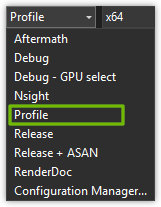

The build artifacts will be located in directory:

`<repo>\tools\editor\bin\Profile`

Now you will able to use _PIX_ for _CPU_ tracing.

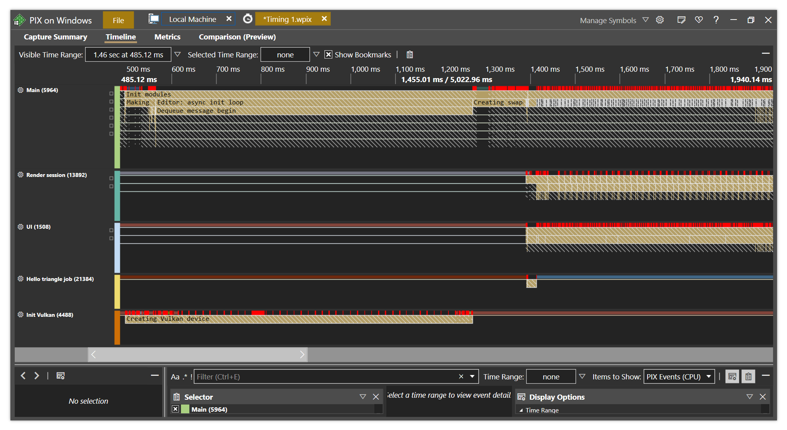

[↬ table of content ⇧](#table-of-content)

### <a id="asan-integration">_ASAN_ integration</a>

First step is to select _Release + ASAN_ build configuration:

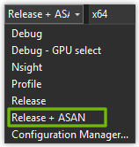

The build artifacts will be located in directory:

`<repo>\tools\editor\bin\Release + ASAN`

Now you will able to use [_ASAN_ features](https://learn.microsoft.com/en-us/cpp/sanitizers/asan?view=msvc-170).

[↬ table of content ⇧](#table-of-content)

### <a id="debug-build">Debug build</a>

First step is to select _Debug_ build configuration:

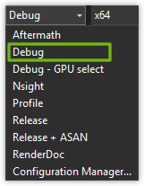

The build artifacts will be located in directory:

`<repo>\tools\editor\bin\Debug`

Build activates: _VVL_ with core, best practices and sync validation features.

[↬ table of content ⇧](#table-of-content)

### <a id="release-build">Release build</a>

First step is to select _Release_ build configuration:

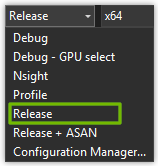

The build artifacts will be located in directory:

`<repo>\tools\editor\bin\Release`

Build features:

- all _CPU_ optimizations are enabled
- _VVL_ are disabled

[↬ table of content ⇧](#table-of-content)

## <a id="hotkeys">_Hotkeys_</a>

### <a id="global-hotkeys">_Global_</a>

**Hotkey** | **Action**
--- | ---
`Ctrl+Z` | Undo
`Ctrl+Shift+Z` | Redo
`Ctrl+Shift+Alt+U` | Make _UI_ layout snapshot. The `.svg` file will be located in `%APPDATA%\Goshido Inc\Editor\Layout` directory
`Ctrl+Shift+Alt+M` | Make _Vulkan_ memory snapshot. The `.json` file will be located in `%APPDATA%\Goshido Inc\Editor\Vulkan memory` directory. More about it is [here](./vulkan-memory-view.md)

[↬ table of content ⇧](#table-of-content)

### <a id="viewport-hotkeys">_Viewport_</a>

**Hotkey** | **Context** | **Action**
--- | --- | ---
`MMB + WASD` | - | Free-fly mode: navigate the scene using first-person shooter controls
Hold `LMB` + mouse move | - | Multi-selection
`Ctrl+LMB` | Without multi-selection | Toggle selection
Hold `Ctrl` | Multi-selection is in progress | Remove from selection
`Shift+LMB` | Without multi-selection | Toggle selection
Hold `Shift` | Multi-selection is in progress | Append to selection
`Esc` | Multi-selection is in progress | Cancel changes in selection

[↬ table of content ⇧](#table-of-content)

### <a id="gizmo-hotkeys">_Gizmo_</a>

**Hotkey** | **Context** | **Action**
--- | --- | ---
`W` | - | Select move tool
`E` | - | Select rotate tool
`R` | - | Select scale tool
`X` | - | Toggle between local and world coordinate systems
`RMB` | Operation is in progress | Cancel active operation
`Esc` | Operation is in progress | Cancel active operation

[↬ table of content ⇧](#table-of-content)

### <a id="property-tool-hotkeys">_Property tool_</a>

**Hotkey** | **Context** | **Action**
--- | --- | ---
`F1` | | Show/hide tool
`LMB` | Cursor is above component header | Collapse/expand component
`Ctrl+LMB` | Cursor is above component header | Toggle component selection
`Del` | At least one component is selected | Delete components

[↬ table of content ⇧](#table-of-content)

### <a id="transform-tool-hotkeys">_Transform tool_</a>

**Hotkey** | **Context** | **Action**
--- | --- | ---
`F2` | - | Show/hide tool
`Tab` | Editing is in progress | Switch to the next property
`Esc` | Editing is in progress | Cancel changes

[↬ table of content ⇧](#table-of-content)
